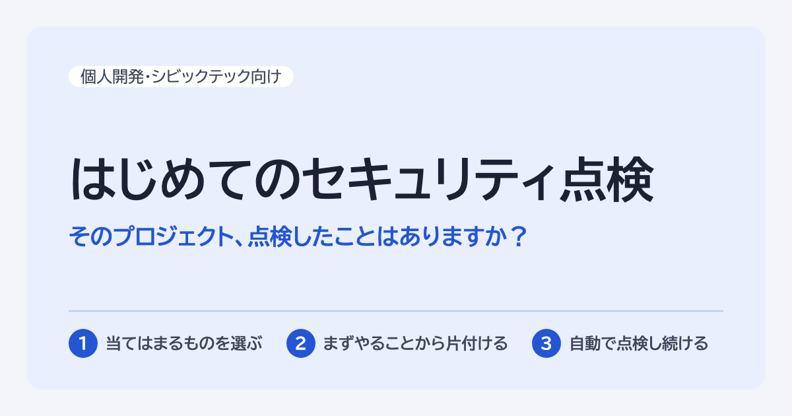

# はじめてのセキュリティ点検

専任のセキュリティ担当がいないプロジェクトのための、セキュリティの点検表です。

**https://yokinist.github.io/first-security-checkup/**

- プロジェクトに当てはまるもの（Firebase、ログイン機能、個人情報など）を選ぶと、確かめるべき項目が「まずやる」「次にやる」「余裕ができたら」の優先度つきで出てきます
- 各項目に、放っておくと何が起きるか、なぜ必要か、使えるツールやコマンド、関連資料を載せています
- 選んだものと進み具合をまとめた相談文を作り、ChatGPT や Claude などの AI に相談できます
- チェックの状態はブラウザにだけ保存され、どこにも送られません

> [!NOTE]
> すべての項目を満たしても、安全を保証するものではありません。よくある穴を減らすための目安です。個人情報を多く扱うときや、自治体などと契約して運用するときは、専門家による診断も検討してください。

## 毎週、自動で点検し続ける（試験運用中）

点検表のうち、自動で調べられる部分（依存パッケージの脆弱性、漏れたキー、ワークフローの危ない書き方、それらを見つける機能が無効になっていないか）は、GitHub Action [weekly-security-checker](https://github.com/yokinist/weekly-security-checker) で毎週見張れます。アカウントや organization のリポジトリをまとめて調べ、指摘を非公開のリポジトリの Issue にまとめます。放置されたリポジトリほど危ないからです。

試験運用中なので、動かしてみた感想や、うまく動かなかったことを [weekly-security-checker の Issue](https://github.com/yokinist/weekly-security-checker/issues) で教えてください。

## 文章だけで読む・ほかのツールで使う

| ファイル | 中身 |
|---|---|
| [checklist.md](https://yokinist.github.io/first-security-checkup/checklist.md) | すべての項目を文章で並べた版 |
| [checklist.json](https://yokinist.github.io/first-security-checkup/checklist.json) | 条件と項目の対応のデータ。使い方と各フィールドの意味も中に書いてあります |
| [llms.txt](https://yokinist.github.io/first-security-checkup/llms.txt) | AI 向けの案内 |

## 直し方

点検項目・条件・優先度・資料は、すべて `data.js` にあります。直すのはこのファイルだけです。

- ページ（`index.html`）は `data.js` をそのまま読み込みます。ビルドは不要で、外部のライブラリも使っていません（フォントだけ Google Fonts から読み込みます）
- `checklist.json`・`checklist.md`・`llms.txt` は、main に入ったときに GitHub Actions が `export.js` で作り、ページと一緒に公開します。リポジトリには置きません
- PR では、同じ `export.js` が `data.js` の書き方を確かめます。手元では `node export.js` で確かめられます

共有用の画像 `ogp.png` は、`ogp.html` をブラウザで 1200×630 にして撮ったものです。名前や見出しを変えたら撮り直します。

## ご意見・誤りの報告

点検項目の誤りや、足したほうがよい項目は [Issue](https://github.com/yokinist/first-security-checkup/issues) で教えてください。このページ自体のセキュリティ上の問題は、[SECURITY.md](SECURITY.md) の手順で、公開せずに知らせてください。

## ライセンス

- 文章とデータ（`data.js`、公開している `checklist.md`・`checklist.json`・`llms.txt`、`ogp.png`）：[CC BY 4.0](LICENSE-CONTENT.md)
- コード（`index.html`、`export.js`、`ogp.html`、`.github/` のワークフロー）：[MIT](LICENSE)

出典を示せば、自由に使ったり変えたりできます。出典の示し方の例：「はじめてのセキュリティ点検（https://yokinist.github.io/first-security-checkup/）、CC BY 4.0」
